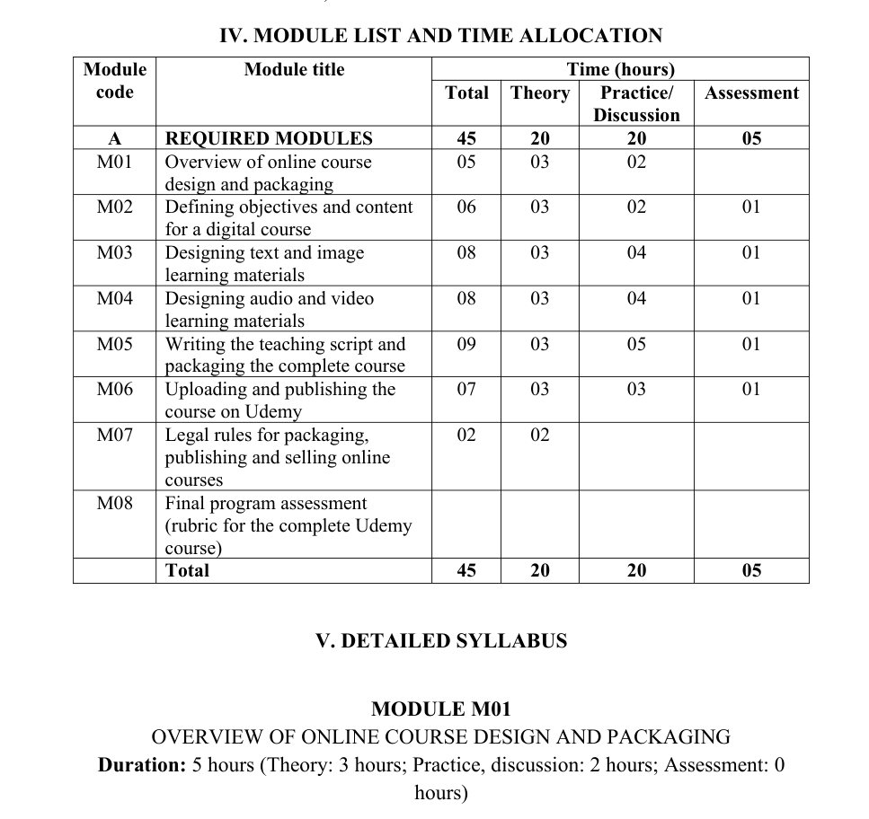

# Curriculum Designer: a Claude Skill for competency-based course and training program design

**Curriculum Designer is an open-source Agent Skill for Claude that turns a course idea into a complete training program: modules, lessons, measurable learning objectives, an hour-by-hour time allocation, an assessment plan and delivery guidelines, exported as Word (.docx) and Markdown.**

You type one sentence, for example "build a 24-hour onboarding program for new support agents". Claude analyzes the job, derives the modules from it, writes the objectives, and hands back a formatted document you can send to a training manager or an accreditation reviewer.

It works in Claude Code, the Claude desktop and web apps, and the Claude Agent SDK. MIT licensed. Output in English or Vietnamese.

Companion skill: [Lesson Content Writer](https://github.com/chuonglife/lesson-content-writer-skill) takes each lesson of the program and writes it out in full, with objectives, instructor script, questions, practice, quiz and handouts. Then [Lesson Slide Designer](https://github.com/chuonglife/lesson-slide-designer-skill) turns each lesson into a teaching slide deck (PowerPoint) and a video script. Finally, [Lesson Video Producer](https://github.com/chuonglife/lesson-video-producer-skill) turns the slides into a narrated, animated lesson video.



## Contents

- [What you get](#what-you-get)
- [Who it is for](#who-it-is-for)
- [Install](#install)
- [Use it](#use-it)
- [How the skill works](#how-the-skill-works)
- [The document structure](#the-document-structure)
- [The design rules it enforces](#the-design-rules-it-enforces)
- [Example output](#example-output)
- [FAQ](#faq)
- [Sources and credits](#sources-and-credits)

## What you get

Four files per program, all generated from one `program.json`:

| File | Content |
|---|---|
| `01_Training_Program.docx` | The full program document, ready to print or submit |
| `01_Training_Program.md` | The same document in Markdown, for wikis, Git and LMS import |
| `00_Program_Overview.docx` | A one-page tree of the program: modules, lessons, topics, hours |
| `00_Program_Overview.md` | The same tree in Markdown |

The overview looks like this:

```
Program: PACKAGING AND PUBLISHING AN ONLINE COURSE ON UDEMY (45 hours)
|-- M01 - Overview of online course design and packaging (5 hours: Theory 3, Practice 2, Assessment 0)
|   |-- Lesson 1: Digital teaching and online courses (2 hours)
|   |   |-- Digital teaching and learning
|   |   `-- Where a Udemy course sits in the online learning model
|   `-- Lesson 2: The online course design process (3 hours)
|-- M02 - Defining objectives and content for a digital course (6 hours: Theory 3, Practice 2, Assessment 1)
...
`-- M08 - Final program assessment (rubric for the complete Udemy course)
```

## Who it is for

- **Teachers and lecturers** who have to write a syllabus or a module outline in a formal format.
- **Corporate trainers and L&D teams** building onboarding, compliance or skills programs.
- **Online course creators** on Udemy, Coursera, Teachable, Kajabi or Thinkific who want a structured curriculum before recording.
- **Instructional designers** who want a first draft that already follows competency-based training (CBT) rules.
- **Vocational and technical (TVET) institutions** that must document programs with objectives, hours and assessment per module.

## Install

**Claude Code (personal, all projects)**

```bash
git clone https://github.com/chuonglife/curriculum-designer-skill ~/.claude/skills/curriculum-designer
```

**Claude Code (one project only)**

```bash
git clone https://github.com/chuonglife/curriculum-designer-skill .claude/skills/curriculum-designer
```

**Claude desktop or web app**

Download `curriculum-designer.skill` from the [latest release](https://github.com/chuonglife/curriculum-designer-skill/releases/latest) and add it under Settings, Capabilities, Skills.

**One dependency**

```bash
pip install python-docx
```

## Use it

Ask in plain language. The skill triggers on requests about courses, training programs, syllabi and learning outcomes.

```
Build a 40-hour training program on data analysis with Excel for accountants.
```

```
I teach high school chemistry. Turn my lab safety unit into a 12-hour module
with measurable objectives and an assessment plan.
```

```
Here is my rough outline for a Udemy course on public speaking. Restructure it
as a competency-based curriculum and export Word files.
```

To change something afterwards, tell Claude what to change. It edits `program.json` and rebuilds, so the summary table and the module pages never disagree. You can also run the builder yourself:

```bash
python scripts/build_docs.py programs/my-course/program.json
```

## How the skill works

1. **Pin down the brief.** Title, target learners, total hours, delivery mode, source material. Missing details become stated assumptions.
2. **Analyze the work.** A small DACUM-style table of duties and tasks. One duty becomes one module. One task becomes one lesson.
3. **Write objectives at three levels.** Program, module and lesson, each in three groups: Knowledge, Skills, Autonomy and responsibility.
4. **Write lesson content and module sections.** Numbered outlines, delivery conditions, assessment, teaching guidelines, references.
5. **Build.** A Python script sums the hours, draws the tables and writes the .docx and .md files.
6. **Review.** A 20-point checklist on alignment between objectives, content and assessment.

## The document structure

Every program has the same six sections, and every module the same seven. A fixed frame makes two programs comparable and makes a missing piece obvious.

| Program level | Module level |
|---|---|
| I. Target learners | 1. Position and nature of the module |
| II. Program objectives | 2. Module objectives |
| III. Program duration and time units | 3. Module content (time table + detailed lessons) |
| IV. Module list and time allocation | 4. Conditions for delivery |
| V. Detailed syllabus | 5. Assessment content and methods |
| VI. Program implementation guidelines | 6. Implementation guidelines |
| | 7. References |

The frame comes from Appendix I of Circular 06/2022/TT-BLDTBXH, the national pedagogical training standard for vocational teachers in Vietnam. It was chosen because it forces hours, objectives and assessment to be stated at every level.

## The design rules it enforces

- **Objective formula.** Action verb + object + conditions + performance standard. "Edit a 5 to 8 minute lecture video from a written script, with clean audio and at least 2 interaction points" passes. "Understand video editing" does not.
- **No unmeasurable verbs.** The build script warns when an objective opens with understand, know, learn, be aware of, be familiar with, appreciate.
- **Three objective groups everywhere.** Knowledge, Skills, Autonomy and responsibility at program, module and lesson level. A missing group raises a warning.
- **Hours add up or nothing is written.** Lesson hours are the only numbers you enter. If a declared total disagrees with the sum, the script stops.
- **Practice outweighs theory in skill modules.** The reference ratio is about one third theory to two thirds practice.
- **Modules come from the job, not from a table of contents.** Each module maps to a duty a graduate must perform.
- **No invented references.**

## Example output

A real 45-hour program, 8 modules, 16 lessons: [examples/udemy-course-packaging](examples/udemy-course-packaging)

- [01_Training_Program.md](examples/udemy-course-packaging/01_Training_Program.md)
- [00_Program_Overview.md](examples/udemy-course-packaging/00_Program_Overview.md)
- [program.json](examples/udemy-course-packaging/program.json), the data behind both

A 24-hour corporate onboarding program, 4 modules, 8 lessons, produced by Claude from a single sentence with no edits: [examples/support-agent-onboarding](examples/support-agent-onboarding)

## FAQ

### What is a Claude Skill?

A Claude Skill (Agent Skill) is a folder with a `SKILL.md` file, optional reference documents and scripts. Claude loads it when a request matches the skill's description, then follows its instructions. Skills run in Claude Code, the Claude apps and the Claude Agent SDK.

### What is competency-based curriculum design?

It is a way of designing training that starts from what a person must be able to do on the job. The designer lists the duties and tasks of the role, turns each duty into a module, and writes objectives that an assessor can observe and measure. It is also called competency-based training (CBT) or outcome-based education.

### How is this different from asking an AI to "write me a course outline"?

A plain prompt returns a list of topics. This skill returns a specification. Hours are computed, not guessed. Every lesson has objectives in three groups with a performance standard. Assessment content mirrors the objectives. The structure is identical from one program to the next, and the output is a formatted Word file.

### Can I use it for a Udemy, Coursera or Teachable course?

Yes. For self-paced video courses the skill counts theory as video watching time and practice as time spent following along and doing assignments, so total hours describe learner effort, not video length. The bundled example is a Udemy course.

### Does it work for corporate training and employee onboarding?

Yes. Give it the role, the starting level of the new hires and the hours available. It was tested on a 24-hour customer support onboarding program.

### Which learning objective taxonomy does it use?

Bloom's revised taxonomy (Anderson and Krathwohl, 2001) for knowledge, Dave's levels for psychomotor skills, and Krathwohl's affective levels for autonomy and responsibility. The verb tables are in [references/design-principles.md](references/design-principles.md).

### What is DACUM and why does the skill use it?

DACUM (Developing A Curriculum) is an occupational analysis method from Canada, first used in 1968. Expert workers describe their job as duties and tasks, and the curriculum is built from that map. The skill uses a short version of it so that modules reflect real work.

### Can I change the document template or the language?

The section order is fixed on purpose. Headings exist in English and Vietnamese. Set `"language": "en"` or `"vi"` in `program.json`. To add a language, add one block to the `LABELS` dictionary in `scripts/build_docs.py`.

### Do I need to know Python?

No. Claude runs the script. You need Python 3.8 or later and `python-docx` installed.

### Is it free?

Yes. MIT license. Use it, change it, ship it in your own products.

## Repository layout

```
SKILL.md                         instructions Claude follows
references/design-principles.md  process, objective formula, verb tables, checklist
references/program-framework.md  the fixed document frame
references/sample-module.md      one complete module for calibration
references/overview-format.md    format of the overview tree
templates/program.example.json   full data example
scripts/build_docs.py            JSON to .docx and .md
examples/                        generated sample output
```

## Sources and credits

- Circular 06/2022/TT-BLDTBXH, Appendix I (Vietnam, Ministry of Labour, Invalids and Social Affairs): document structure and the calibration module.
- Nguyen Van Tuan (2022), *Training program development*, Ho Chi Minh City University of Technology and Education.
- Diep Phuong Chi (2026), course slides on training program development, Ho Chi Minh City University of Technology and Education.
- Tyler (1949), Wentling (1993), Anderson and Krathwohl (2001), Norton (1997, *DACUM Handbook*).

The skill was first written in Vietnamese by Chuong for his own Udemy course production line for teachers and trainers, then generalized and translated for public use.

## Contributing

Issues and pull requests are welcome, especially new heading languages and worked examples from other fields.

## License

[MIT](LICENSE)
